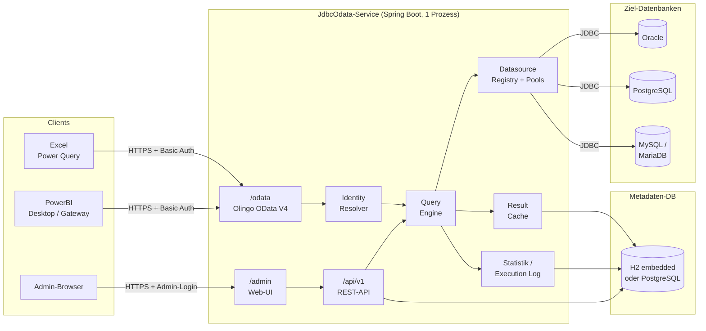
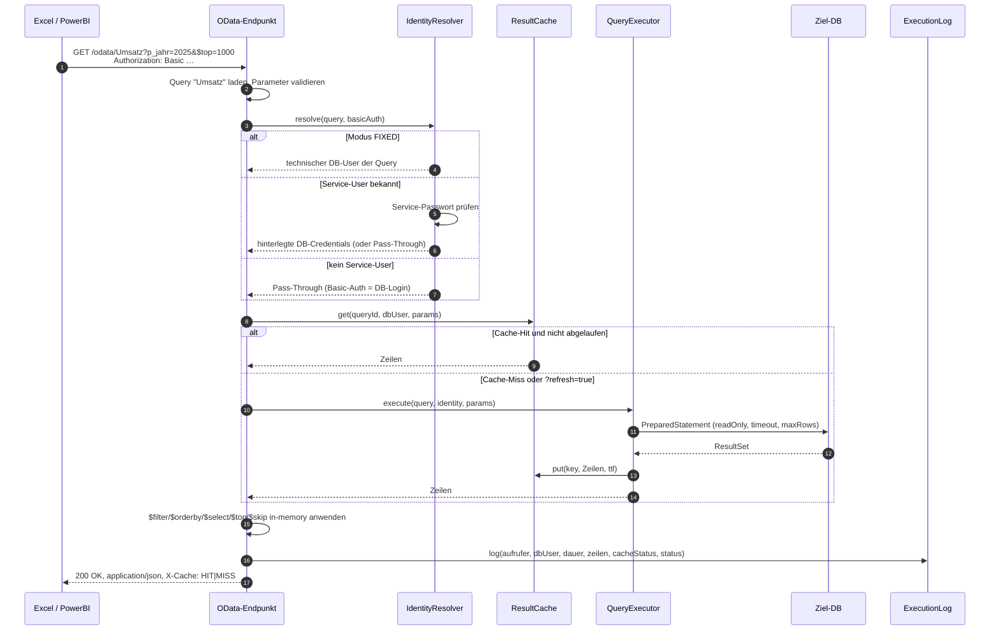
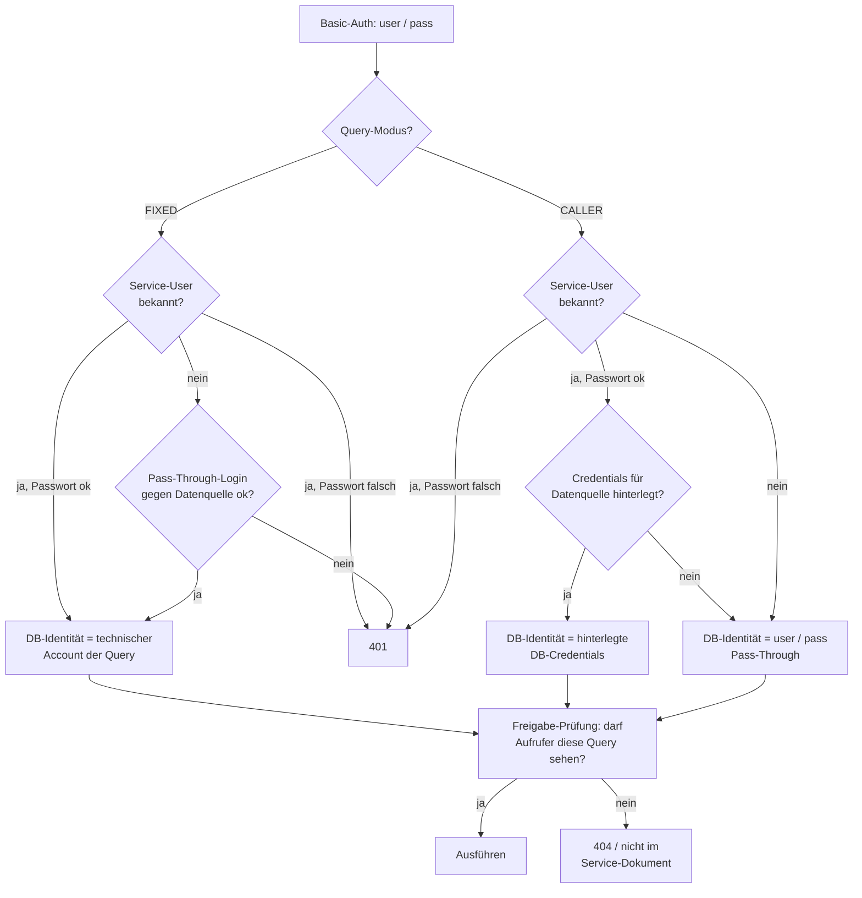
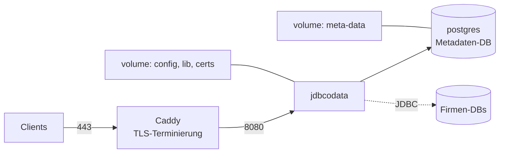

# JdbcOdata – Architektur

Stand: 2026-10-16 · Status: Release 1.0 (M1 bis M4 umgesetzt)

JdbcOdata stellt SQL-Abfragen gegen firmeninterne Datenbanken als OData-V4-Feeds für Excel und PowerBI bereit. Abfragen werden zur Laufzeit von Admins verwaltet, laufen unter der DB-Identität des anfragenden Users, werden pro User gecacht und vollständig protokolliert.

## 1. Überblick



**Technologie-Stack**

| Baustein | Wahl | Begründung |
|---|---|---|
| Sprache / Runtime | Java 21 (LTS) | Läuft nativ auf Linux und Windows, ein Artefakt für alle Plattformen |
| Framework | Spring Boot 4.x (Spring Framework 7, Spring Security 7, Hibernate 7) | Spring Boot 3.5 ist seit Mitte 2026 aus dem OSS-Support; 4.x ist die gepflegte Linie |
| OData | Apache Olingo 5.0 (Server-Core + JSON, Jakarta Servlet) | Reifste OData-V4-Server-Implementierung in Java; parst URL und Query-Optionen, serialisiert JSON und `$metadata` |
| DB-Zugriff | JDBC + HikariCP | Oracle, PostgreSQL, MySQL/MariaDB über offizielle Treiber; weitere DBs ohne Codeänderung |
| SQL-Validierung | JSqlParser | Nur `SELECT`/`WITH` zulassen, Parameter erkennen |
| Metadaten-DB | H2 (Datei) standardmäßig, PostgreSQL optional | Keine Zusatzinstallation lokal, Mehrinstanz-Betrieb in Docker |
| Persistenz | Spring Data JPA + Flyway | Schema-Migrationen versioniert, Upgrade-Pfad |
| Admin-UI | Thymeleaf + htmx + CodeMirror | Kein Node-Build, im JAR gebündelt |
| Cache (hot) | Caffeine | In-Memory-Layer vor der persistenten Cache-Tabelle |
| Build | Maven, Fat-JAR | `java -jar`, Multi-Stage-Dockerfile |

## 2. Module

Ein einzelner Spring-Boot-Prozess, intern in Packages unter `at.jdbcodata.*` geschnitten. Abhängigkeiten laufen nur von oben nach unten.

| Package | Verantwortung | Wichtige Klassen (geplant) |
|---|---|---|
| `odata` | Olingo-Servlet unter `/odata`, dynamischer `CsdlEdmProvider` aus Query-Definitionen, Service-Dokument, `$metadata`, `EntityCollectionProcessor` | `DynamicEdmProvider`, `QueryEntityCollectionProcessor`, `ODataQueryOptionEvaluator` |
| `admin` | Web-UI (`/admin`) und REST-API (`/api/v1`), Admin-Authentifizierung, Rollen | `QueryController`, `DatasourceController`, `StatsController` |
| `query` | Query-Definitionen (CRUD), SQL-Validierung, Parameter-Deklaration, Schema-Snapshot, Ausführung | `QueryDefinition`, `QueryValidator`, `SchemaSnapshotService`, `QueryExecutor` |
| `identity` | Auflösung der Ausführungsidentität, Service-User, hinterlegte Credentials, Verschlüsselung | `ExecutionIdentityResolver`, `CredentialVault`, `ServiceUser` |
| `cache` | Ergebnis-Cache pro (Query, DB-User, Parameter), TTL, Invalidierung | `ResultCache`, `CacheKey`, `CacheEntry` |
| `stats` | Ausführungsprotokoll, Aggregationen, Retention, Micrometer-Metriken | `ExecutionLog`, `StatsService`, `RetentionJob` |
| `datasource` | Datenquellen-Registry, Connection-Pools pro Identität, Treiber-Laden | `DatasourceRegistry`, `IdentityPoolManager`, `DriverLoader` |
| `config` | `application.yml`, Env-Vars, Master-Key, TLS, Initial-Admin | `JdbcOdataProperties`, `MasterKeyProvider` |

## 3. Request-Fluss (OData-Abruf aus Excel)



Fehlerfälle: DB-Login schlägt fehl → `401` mit `WWW-Authenticate: Basic`, damit Excel erneut nach Credentials fragt. Query-Fehler → `500` mit OData-Fehlerobjekt, Fehlermeldung landet im Log, aber ohne SQL-Text im Response.

## 4. OData-Modell

**Eine Query ist ein EntitySet.** Der Admin vergibt einen Identifier (`[A-Za-z][A-Za-z0-9_]*`), der als EntitySet-Name im Service-Dokument erscheint. Der EntityType heißt gleich, Namespace `JdbcOdata`.

**Schema-Snapshot.** Beim Speichern oder Testen einer Query wird sie einmal mit `setMaxRows(1)` unter den Test-Credentials des Admins ausgeführt. Die `ResultSetMetaData` (Spaltenname, JDBC-Typ, Precision, Scale, Nullable) wird in `query_column` persistiert. `$metadata` wird ausschließlich aus dem Snapshot gebaut und braucht keinen DB-Zugriff. Ändert sich das DB-Schema, aktualisiert der Admin den Snapshot per Knopfdruck.

**Schlüssel.** OData verlangt eine Key-Property. Standard ist ein synthetisches `RowId` (`Edm.Int64`, Zeilenindex des Ergebnisses). Alternativ markiert der Admin eine oder mehrere Spalten als Key.

**Typmapping JDBC → EDM**

| JDBC-Typ | EDM-Typ | Hinweis |
|---|---|---|
| CHAR, VARCHAR, NVARCHAR, CLOB, NCLOB | `Edm.String` | CLOB wird vollständig gelesen |
| TINYINT, SMALLINT, INTEGER | `Edm.Int32` | |
| BIGINT | `Edm.Int64` | |
| NUMERIC, DECIMAL | `Edm.Decimal` | Precision/Scale aus Metadaten; Oracle `NUMBER` ohne Scale → `Edm.Decimal` |
| REAL, FLOAT, DOUBLE | `Edm.Double` | |
| DATE | `Edm.Date` | |
| TIME | `Edm.TimeOfDay` | |
| TIMESTAMP, TIMESTAMP WITH TIME ZONE | `Edm.DateTimeOffset` | Ohne Zone: Server-Zeitzone, konfigurierbar |
| BOOLEAN, BIT | `Edm.Boolean` | |
| BINARY, VARBINARY, BLOB | `Edm.Binary` | Standardmäßig aus dem EntityType ausgeblendet |
| Sonstige | `Edm.String` | `toString()`, mit Warnung im Snapshot |

**Query-Optionen.** `$top`, `$skip`, `$filter`, `$select`, `$orderby`, `$count` werden von Olingo geparst und **in-memory** auf der vollständigen Ergebnismenge (aus Cache oder DB) ausgewertet (`QueryOptionsEvaluator`, `EntityExpressionVisitor`). Reihenfolge: `$filter` → `$orderby` → `$count` → `$skip` → `$top`. Unterstützt in `$filter`: Vergleiche, `and`/`or`/`not`, `in`, Arithmetik, String-Funktionen (`contains`, `startswith`, `endswith`, `length`, `indexof`, `substring`, `tolower`, `toupper`, `trim`, `concat`), Datumsfunktionen (`year` … `second`, `date`, `time`, `now`), `round`/`floor`/`ceiling`. Das ist der Standard, weil die Ergebnismenge ohnehin pro User gecacht wird und Excel beim Laden meist den gesamten Feed holt; für große Ergebnisse gibt es den Push-Down (unten). `$expand` folgt den deklarierten Beziehungen (siehe unten), ebenso Navigationspfade in `$filter` und `$orderby`: einwertige Navigationen auch verkettet (`Kunde/Region eq 'Nord'`, `$orderby=Kunde/Name`, `Kunde eq null`), `any`/`all` über Sammlungen (`Umsaetze/any(u:u/Betrag gt 1000)`, auch verschachtelt und mit Navigation im Rumpf) und `Umsaetze/$count`. Eine fehlende verknüpfte Zeile vergleicht wie `NULL`. Die Ziel-Query wird wie bei `$expand` einmal pro Request ausgeführt und über die Spaltenpaare zugeordnet.

**Umschreiben vor dem Parsen (Olingo-5-Lücken).** Einige gültige Formen lehnt der Olingo-5-Parser ab; JdbcOdata schreibt sie vorher um (`QueryRewriter`, `ExpressionRewriter`, `KeySegmentRewriter`), String-Literale bleiben dabei unberührt:

| Form | Umschreibung | Hinweis |
|---|---|---|
| `any(u: u/Betrag gt 1)` | Leerzeichen um den Lambda-Doppelpunkt entfallen | |
| `matchesPattern(Name,'^L.*AG$')` | `contains(Name,concat('<Marke>','^L.*AG$'))`, die Auswertung erkennt die Marke | Java-Regex mit Suche (Anker `^`/`$` setzen); pro Zeile höchstens 100 000, pro Request 20 Mio. Lesezugriffe, sonst 400; nie Push-Down |
| `Umsaetze/$count($filter=Betrag gt 1000)` in `$filter`/`$orderby` | `cast(Umsaetze/any(jdbcodata_c1:jdbcodata_c1/Betrag gt 1000),Edm.Int64)`; eine Lambda-Variable `jdbcodata_c…` zählt die Treffer | nur `$filter` im `$count`, kein `$search` |
| `case(Region eq 'Nord':'N',true:'andere')` (4.01) | `cast(@jdbcodata_case1,Edm.String)`, die Zweige als interne Option; die Auswertung parst sie für den Typ der Zeile | Ergebnistyp aus den Werten (Literal, Property, Funktion); Doppelpunkt mit Leerzeichen schreiben, wenn eine Bedingung auf eine zweistellige Zahl endet und der Wert mit einer beginnt; auch in Lambda-Rümpfen (`Umsaetze/any(u:case(u/Betrag gt 1000:true,true:false))`, die Lambda-Variablen werden beim Parsen der Zweige zu einwertigen Navigationen der Zeile) und in `$count($filter=…)` (die Zweige bekommen dort das Präfix der Zähl-Variablen) |
| `Kunden/$filter(Region eq 'Nord')/$count` (4.01) | Filtersegmente am Ende einer Collection werden per `and` mit `$filter` verknüpft | auch mehrere hintereinander und nach Navigation (`Kunden(1)/Umsaetze/$filter(…)`) |
| `Kunden/1/Umsaetze/5` (Key-as-Segment, 4.01) | `Kunden(1)/Umsaetze(5)` anhand des EDM | nur einteilige Schlüssel; String-Schlüssel ohne Anführungszeichen (`Kunden/Linzer%20Bau`); auch in den Teilen eines `$batch` |

`fractionalseconds` auf `Edm.Date` bleibt abgelehnt: Die Spezifikation erlaubt die Funktion nur für `Edm.DateTimeOffset` und `Edm.TimeOfDay`. `$select` mit Optionen (`$select=Adressen($filter=…)`) gilt nach 4.01 nur für Collection-Properties primitiver oder komplexer Typen; solche Properties gibt es bei SQL-Ergebnissen nicht, für Navigationen ist `$expand` mit Optionen der Weg.

**Ressourcenpfade.** Neben EntitySets werden einzelne Entitäten (`Umsatz(1)`, `Kunden(KundeId=1)`), Navigationspfade (`Umsatz(1)/Kunde`, `Kunden(1)/Umsaetze` mit allen Collection-Optionen, Ketten wie `Kunden(1)/Umsaetze(5)/Produkt`, `…/$count`) und Properties (`Kunden(1)/Name`, `…/$value`) bedient. Ein fehlender Schlüssel ergibt 404, eine einwertige Navigation ohne verknüpfte Zeile oder ein `NULL`-Wert 204. Schreibzugriffe liefern 405.

**Paging, ETags, Aliase, `$batch`.** Mit `jdbcodata.odata.page-size` oder `Prefer: odata.maxpagesize` liefert der Service Seiten mit `@odata.nextLink`; `$skiptoken` ist die Anzahl bereits gelieferter Zeilen des Ergebnisses nach `$filter`/`$orderby`/`$skip`/`$top`, Folgeseiten kommen aus demselben Cache-Eintrag (ohne Cache kann sich das Ergebnis zwischen zwei Seiten ändern). Jede Leseantwort trägt ein schwaches ETag (Hash des Inhalts), `If-None-Match` ergibt 304; `$metadata` und Service-Dokument haben ein ETag aus den sichtbaren Query-Versionen. Antworten sind `Cache-Control: private, no-cache` mit `Vary: Authorization`. Parameter-Aliase (`$filter=Name eq @n&@n='Wien'`) werden ausgewertet. `$batch` (multipart/mixed) führt Leseteile wie Einzelanfragen unter derselben Identität aus, mit denselben Umschreibungen (Key-Segmente, `$filter`-Segmente, `$compute`, `case()`, …); Changesets enden mit 405.

**Änderungsverfolgung (Delta-Links).** Mit `Prefer: odata.track-changes` trägt die (letzte Seite der) Antwort einen `@odata.deltaLink` und `Preference-Applied: odata.track-changes`. Der Token nennt einen Schnappschuss des gelieferten Ergebnisses im Speicher (Entity-Id → Hash der Werte; `DeltaTracker`, höchstens 1000 Token für 24 h, nur für denselben Aufrufer und dieselben Optionen). Der Abruf des Links wertet die Anfrage erneut aus und vergleicht: neue und geänderte Entitäten kommen vollständig (mit `$select`/`$expand`), verschwundene als gelöschte Entitäten (`"@odata.context":"#Set/$deletedEntity"` bzw. mit `OData-MaxVersion: 4.01` als `@removed`), mit Grund `changed`, wenn die Anfrage `$filter` oder `$search` hat (die Zeile kann auch nur aus dem Filter gefallen sein), sonst `deleted`; der Kontext endet auf `/$delta`, die Antwort trägt den nächsten Delta-Link. Ein unbekannter oder abgelaufener Token (z. B. nach einem Neustart) ergibt 410 Gone, dann den Feed neu laden. Nicht verfolgbar sind Anfragen mit `$top`/`$skip` und `$apply` (die Präferenz wird dann nicht angewendet, `$deltatoken` ergibt 400); bei Queries mit Zeilennummer als Schlüssel gilt jede Verschiebung als Änderung, deshalb meldet `$metadata` `Capabilities.ChangeTracking` nur für Queries mit Schlüsselspalten. Mit aktivem Ergebnis-Cache sieht der Vergleich Änderungen erst nach Ablauf des Cache-Eintrags.

**`$search`.** Ein Begriff oder eine Phrase (`"Linzer Bau"`) trifft, wenn ein Feld ihn enthält (ohne Groß-/Kleinschreibung; Zahlen in Klartextnotation, Datum ISO); `AND`, `OR`, `NOT`, auch innerhalb von `$expand` und `$apply`.

**`$apply`** (Data Aggregation Extension), in-memory: `filter`, `search`, `orderby`, `top`, `skip`, `identity`, `compute`, `concat`, `aggregate` (`sum`, `min`, `max`, `average`, `countdistinct`, `$count as N`, `Nav/$count as N`, Inline-Aggregate `Umsaetze(Betrag with sum as S)`, `from` in Olingo-Schreibweise `Betrag with sum as M from KundeId with max`), `groupby` (auch über einwertige Navigationen, mit verschachtelter Folge, `rollup(P1,P2)` und `rollup($all,P1,P2)`) sowie `topcount`/`bottomcount`/`topsum`/`bottomsum`/`toppercent`/`bottompercent`. Danach gelten `$filter`, `$orderby`, `$top`, `$skip`, `$count`, `$select` auf dem Ergebnis, auch mit Aliasnamen. `$expand` ist möglich, solange `$apply` die Entitäten erhält (filter, search, orderby, top, skip, compute); `$apply` ist auch innerhalb von `$expand` erlaubt (`Kunden?$expand=Umsaetze($apply=aggregate(Betrag with sum as S))`). Die Transformation `expand(Umsaetze,filter(Betrag gt 1000),expand(Produkt))` hängt die (gefilterten) verknüpften Zeilen an jede Zeile; folgende Schritte und Optionen sehen genau diese (`expand(…)/filter(Umsaetze/$count gt 0)`). Eigene Aggregationsmethoden (im `$metadata` als `Aggregation.CustomAggregationMethods`): `Betrag with JdbcOdata.median as M`, `JdbcOdata.stddev`/`stddevp` (Stichprobe/Grundgesamtheit), `JdbcOdata.variance`/`variancep`. Benannte Custom Aggregates (`aggregate(Umsatz)` ohne `with`) sind nicht definiert.

**Erweiterte `$apply`-Transformationen** (4.0 CS03 / 4.01), die Olingo 5 nicht parst (`ExtendedApply`): Enthält `$apply` eine davon, reicht das Servlet `$apply`, `$filter`, `$orderby`, `$select` und `$expand` als interne Optionen weiter; JdbcOdata zerlegt die Folge an den obersten `/`, lässt Olingo die Standard-Schritte gegen den Typ der aktuellen Zeilen (`RowType`: Properties, Aliase, Navigationen) parsen und wertet die übrigen selbst aus.

| Transformation | Ergebnis |
|---|---|
| `join(Umsaetze as U[,T])` | eine Zeile je verknüpfter Zeile, diese als einwertige Navigation `U` (`$filter=U/Betrag gt 1000`, `groupby((Region),aggregate(U/Betrag with sum as S))`); `T` filtert/transformiert die verknüpften Zeilen vorher |
| `outerjoin(Umsaetze as U[,T])` | wie `join`, Zeilen ohne Treffer bleiben mit `U` = `null` |
| `nest(T1 as A1,…)` | eine Zeile mit Sammlungs-Navigationen `Ai` = Ergebnis von `Ti`; in `groupby((Region),nest(topcount(1,Betrag) as Groesste))` je Gruppe |
| `ancestors(H,Q,p,T[,d][,keep start])`, `descendants(…)` | Vorfahren bzw. Nachkommen der Startknoten `T` (bis Abstand `d`, mit `keep start` inklusive Start), in Eingabereihenfolge |
| `traverse(H,Q,p,preorder\|postorder[,T])` | die Eingabe in Hierarchie-Reihenfolge, ab den Wurzeln oder den Startknoten `T` |

Für Hierarchien ist `H` = `$root/<EntitySet>`, `Q` der Name einer 1-zu-1-Beziehung der Query auf sich selbst (z. B. `Uebergeordnet`, im `$metadata` als `Aggregation.RecursiveHierarchy#Uebergeordnet` mit `NodeProperty` und `ParentNavigationProperty`) und `p` die Knoten-Property; Zyklen enden beim ersten Wiederbesuch. `join`/`outerjoin` folgen auch Navigationspfaden (`join(Untergeordnet/Untergeordnet as Enkel)`); `rollup` lässt sich mit `nest`/`join` kombinieren (`groupby((rollup($all,Region)),nest(…))` liefert die Gruppen jeder Ebene, Zwischensummen ohne die aufgerollten Properties).

**`$compute`** (4.01) wird vor dem Parsen in `$apply=…/compute(…)` umgeschrieben, weil Olingo 5 die Option nicht kennt; damit funktioniert es zusammen mit `$select`, `$expand`, `$filter` und `$apply`. Auf einzelnen Entitäten (`Kunden(1)?$compute=…`, auch nach Navigation) verbietet Olingo `$apply`; dort reicht das Servlet `$compute` und `$select` als interne Custom Options weiter, der Processor parst sie im Kontext des EntitySets und wendet sie auf die eine Entität an.

**`$levels`** in `$expand` für Beziehungen einer Query auf sich selbst (`$levels=2`, `$levels=max` bis 8 Ebenen). Entitäten, die auf einer früheren Ebene schon vorkamen, werden nicht erneut aufgeklappt, damit Zyklen enden; insgesamt höchstens 200 000 expandierte Entitäten pro Request.

**Weitere Ausdrücke:** `cast(expr, Edm.Typ)` (fehlgeschlagene Konvertierung = `null`), `isof(JdbcOdata.Typ)`, `isof(expr, Edm.Typ)`, `$it` (auch in Lambdas) und `$root/Set(key)/Property`.

**`$ref`** liefert Referenzen statt Entitäten (`Kunden(1)/Umsaetze/$ref`, `Umsatz(1)/Kunde/$ref`, `Kunden/$ref`) mit den Collection-Optionen, ebenso in `$expand` (`$expand=Umsaetze/$ref`, `$expand=*/$ref`). `$expand=Umsaetze/$count` (auch mit `($filter=…;$search=…)`) liefert nur `Umsaetze@odata.count`.

**`$all`** liefert die Entitäten aller sichtbaren EntitySets mit `@odata.type` (typisch mit `$search`; Queries mit Pflichtparametern ohne Wert werden übersprungen). **`$crossjoin(A,B)`** liefert Kombinationen, gefiltert mit Pfaden wie `$filter=Umsatz/KundeId eq Kunden/KundeId`, mit `$orderby`, `$top`, `$skip`, `$count`, `$select` und `$expand=A` (Olingo erlaubt dort keine verschachtelten Optionen); höchstens 2 Mio. Kombinationen. Beide fängt das Servlet ab, weil Olingo sie zwar parst, aber nicht an Processoren weitergibt.

**Beziehungen.** Eine Query kann Beziehungen zu anderen Queries deklarieren (`query_relation`: Name, Ziel-Query, Spaltenpaare, 1-zu-n-Flag, Partner). Sie erscheinen im `$metadata` als `NavigationProperty` des EntityTypes (mit `ReferentialConstraint` bei 1-zu-1-Beziehungen, deren Spalten im Snapshot existieren, und `Partner`, wenn die Gegenseite zurückzeigt) und als `NavigationPropertyBinding` des EntitySets. Damit sehen OData-Explorer, Excel und Power BI, wie die Feeds zusammenhängen. **`$expand`** wird unterstützt: die Ziel-Query läuft mit derselben Ausführungsidentität und denselben Custom Query Options (gemeinsame Parameter wie `p_jahr` gelten für beide), höchstens einmal pro Request und über den Cache; die Zeilen werden in-memory über die Spaltenpaare zugeordnet (typtolerant, `NULL` passt nie). Innerhalb von `$expand` gelten `$select`, `$filter`, `$orderby`, `$skip`, `$top`, `$count` und verschachteltes `$expand` (max. 3 Ebenen), außerdem `$expand=*`; nicht unterstützt sind `$levels`, `$ref` sowie Navigationspfade (`Umsatz(1)/Kunde`). Jede expandierte Query erzeugt einen eigenen Eintrag im Ausführungsprotokoll. Ein Ziel, das der Aufrufer nicht sehen darf oder das nicht existiert, wird samt Beziehung weggelassen, damit das personalisierte Modell nichts verrät.

**Query-Parameter.** SQL darf benannte Parameter `:name` enthalten. Jeder Parameter wird mit Typ (`STRING`, `INT`, `DECIMAL`, `DATE`, `TIMESTAMP`, `BOOLEAN`), Pflicht-Flag und optionalem Default deklariert. Clients übergeben Werte als **Custom Query Options** (`?p_jahr=2025`; OData erlaubt Optionen ohne `$`-Präfix, Excel reicht sie unverändert durch). Werte werden ausschließlich per `PreparedStatement` gebunden und sind Teil des Cache-Keys.

**Push-Down** (pro Query schaltbar, `push_down`). Für `GET Set`, `Set/$count` und `GetSet(...)` wird die Query als Subquery gekapselt: `SELECT * FROM (<sql>) jdbcodata_q WHERE … ORDER BY … OFFSET ? ROWS FETCH NEXT ? ROWS ONLY` (MySQL/MariaDB `LIMIT ? OFFSET ?`), alle Werte als Bind-Parameter. Voraussetzungen: Schlüsselmodus „Spalten“ mit sichtbarem Schlüssel (stabile Sortierung beim Paging, der Schlüssel wird an jedes `ORDER BY` gehängt), Datenbank PostgreSQL, H2, Oracle oder MySQL/MariaDB. `$filter` wird an den obersten `and` zerlegt: übersetzbare Teile gehen in die `WHERE`-Klausel, der Rest wird danach in-memory ausgewertet (`X-Push-Down: filter(partial)`). `$search` geht als `LOWER(Spalte) LIKE '%begriff%'` über die Textspalten in die Datenbank, wenn kein Begriff auch auf den Text einer Zahl, eines Datums oder Booleans passen könnte. Sonst (Begriffe wie `2025`, `e`, `true`, und immer bei MySQL wegen der Collation ohne Groß-/Kleinschreibung und Akzente) filtert die Datenbank vor – mit einer Bedingung, die alle Treffer sicher enthält: Textspalten per `LIKE` oder die Spalten, deren Text den Begriff enthalten könnte (`IS NOT NULL` für Zahlen bei Begriffen aus Ziffern, `.` und `-`, für Datum aus Ziffern und `-` usw., Booleans per Wert); unter `NOT` umgekehrt nur die sicheren Treffer. Die Suche im Speicher entscheidet danach exakt (`X-Push-Down: search(partial)`); Paging bleibt dann im Speicher. `$orderby`, `$skip`, `$top` und `$count` gehen nur in die Datenbank, wenn der ganze Filter und eine eventuelle Suche dort liefen; `$count=true` wird dann als `SELECT COUNT(*)` mit derselben Bedingung ausgeführt, `Set/$count` mit vollständigem Filter nur als `COUNT(*)`. Übersetzt werden Vergleiche, `and`/`or`/`not`, `in`, `add`/`sub`/`mul`, Negation, `contains`/`startswith`/`endswith` (LIKE mit Escape; nicht bei MySQL wegen Collation ohne Groß-/Kleinschreibung), `tolower`, `toupper`, `trim`, `length`, `year`/`month`/`day` auf `Edm.Date`, `hour`/`minute`/`second` auf `Edm.TimeOfDay` und Parameter-Aliase. Bewusst in-memory bleiben: `<`/`>` auf Strings (Collation), `div`/`mod` (Division durch null), `Edm.DateTimeOffset`-Literale und Datumsfunktionen auf Zeitstempeln (Sitzungszeitzone), Navigationen und Lambdas. Die NULL-Semantik entspricht der In-Memory-Auswertung (`eq null` → `IS NULL`, `ne` ist wahr, wenn genau eine Seite `NULL` ist, `not` eines unbekannten Ausdrucks ist wahr, `NULLS FIRST` aufsteigend). Push-Down-Ausführungen umgehen den Ergebnis-Cache; meldet die Datenbank einen Fehler für das gekapselte SQL, antwortet der Service aus dem vollständigen Ergebnis. Der Antwort-Header `X-Push-Down` nennt, was in der Datenbank lief (`filter`, `orderby`, `skip`, `top`, `count`). String-Sortierung folgt bei gepushtem `$orderby` der Collation der Datenbank.

**Parametrisierte Queries als Funktionen.** Jede Query mit Parametern erscheint zusätzlich als komponierbare Funktion `Get<Query>` mit Function-Import auf ihr EntitySet: `GetUmsatz(p_jahr=2024)`, `GetUmsatz(p_jahr=@j)?@j=2024`, `GetUmsatz()` (Defaults). Überladungen gibt es für die Pflichtparameter plus jede Kombination optionaler Parameter (bis 4 optionale, darüber nur „keine“ und „alle“); `null` bedeutet „Default verwenden“. Typen: `INT` → `Edm.Int64`, `DECIMAL` → `Edm.Decimal`, `DATE` → `Edm.Date`, `TIMESTAMP` → `Edm.DateTimeOffset`, `BOOLEAN`, `STRING`. Das Ergebnis verhält sich wie das EntitySet: Schlüssel (`GetUmsatz(p_jahr=2024)(17)`), Navigationen, `/$count` und alle Query-Optionen. Funktionsargumente überschreiben gleichnamige Custom Query Options und gelten wie diese auch für verknüpfte Queries. Heißt eine andere Query bereits `Get<Query>`, entfällt die Funktion.

**Push-Down von `$apply`.** Führende `filter`- und `search`-Schritte werden zur `WHERE`-Klausel, ein folgendes `aggregate` oder `groupby((P1,…),aggregate(…))` über einfache Spalten zu `SELECT … GROUP BY` (`sum`, `min`/`max` auf Zahlen und Datum, `average` als `SUM`/`COUNT` mit derselben Division wie im Speicher, `countdistinct`, `$count`); direkt danach folgende `filter`-, `orderby`-, `skip`- und `top`-Schritte laufen als äußeres `SELECT` über das gruppierte Ergebnis (`HAVING`-artig, z. B. `groupby(…)/filter(S gt 1000)/orderby(S desc)/top(5)`; Paging nur nach einem `orderby`, Gleichstände nach den Gruppierungsspalten), und ist das ganze `$apply` in der Datenbank, auch die übersetzbaren Teile von `$filter` (`apply:groupby,$filter`; im Speicher wird er noch einmal angewendet). Ohne Aggregation gehen `orderby`/`skip`/`top` nach den Filtern mit dem Schlüssel als letztem Sortierkriterium in die Datenbank. Der Rest läuft im Speicher auf dem kleinen Ergebnis (`X-Push-Down: apply:filter,groupby,filter,orderby,top`). Gruppen kommen nach den Gruppierungsspalten sortiert zurück, die Reihenfolge ist also auch ohne `$orderby` stabil (sie kann von der In-Memory-Reihenfolge – erstes Auftreten – abweichen). Filter auf Durchschnitten bleiben im Speicher (die Division geschieht in Java). Nicht in die Datenbank gehen `rollup`, `from`, Ausdrücke, Navigation, Summen über `Edm.Double` (Gleitkomma-Rundung), `min`/`max` auf Strings und Gruppierung nach Zeitstempeln. Eine `search`-Vorfilterung beendet den Push-Down an dieser Stelle (`apply:search(partial)`).

**Annotationen.** Das `$metadata` referenziert die Vokabulare Core, Capabilities und Aggregation (`ApplySupported` mit den Transformationen, `CustomAggregationMethods`, `RecursiveHierarchy`). Beschreibungen von Queries, Beziehungen und Parametern (mit Default) erscheinen als `Core.Description`. Jedes EntitySet trägt Capabilities: Insert/Update/Delete nicht erlaubt, zählbar, durchsuchbar, filter- und sortierbar, `$top`/`$skip`, Zugriff per Schlüssel, `ExpandRestrictions` (expandierbar, wenn Beziehungen bestehen, `MaxLevels` 8); der Container `BatchSupported`, `KeyAsSegmentSupported`, `CrossJoinSupported` und `AsynchronousRequestsSupported=false`. OData-Explorer und Codegeneratoren blenden damit Schreiboperationen aus.

**`$deltatoken`** außerhalb von Entity-Collections (Einzelentität, `$count`, Properties) ergibt 400 statt ignoriert zu werden.

**Format.** JSON nach OData V4 (`application/json;odata.metadata=minimal`; `full` und `none` sowie `IEEE754Compatible=true` – `Edm.Int64` und `Edm.Decimal` als Strings – gelten auch für Ergebnisse mit `$apply`, `$compute` und `$levels`, die JdbcOdata selbst schreibt). Excel „Daten abrufen → Aus OData-Feed“ und der PowerBI-OData-Connector verwenden V4/JSON und unterstützen Basic Auth nativ.

## 5. Identität und Berechtigungen

Jeder OData-Aufruf trägt Basic-Auth-Credentials (daher HTTPS-Pflicht). Einzige Ausnahme: ist `jdbcodata.odata.anonymous-user` gesetzt, laufen Anfragen **ohne** `Authorization`-Header als dieser Service-User (ohne Passwortprüfung, nur mit hinterlegten Credentials bzw. FIXED-Queries; fehlen beide, antwortet der Service mit 401). Die **Ausführungsidentität** ist der DB-User, unter dem die Abfrage tatsächlich läuft. Sie wird in dieser Reihenfolge aufgelöst:



**Modi einer Query**

| Modus | Bedeutung | Typischer Einsatz |
|---|---|---|
| `CALLER` (Standard) | Läuft unter der Identität des Aufrufers (Pass-Through oder hinterlegte Credentials) | Daten, bei denen die DB selbst die Berechtigungen regelt (Row-Level-Security, Views, Grants) |
| `FIXED` | Läuft unter einem auf der Query hinterlegten technischen DB-Account; der Aufrufer wird nur gegen den Service bzw. die Datenquelle authentifiziert | Aggregierte Reports für User ohne eigenes DB-Konto; „Abfrage läuft unter den Berechtigungen eines anderen Users“ |

**Service-User.** Optionales Konto im Service mit eigenem Passwort (bcrypt), Namenskonvention Präfix `svc_`, damit es keine Kollision mit DB-Usernamen gibt. Pro Datenquelle können DB-Credentials hinterlegt werden. Vorteile: ein Login in Excel für mehrere Datenquellen, DB-Passwort-Rotation ohne Excel-Änderung, Zugriff auf `FIXED`-Queries ohne DB-Konto. Ein Flag „Pass-Through erzwingen“ schaltet hinterlegte Credentials für einen Service-User ab. Ohne Service-User gilt reines Pass-Through, der Service speichert nichts.

**PowerBI Service über Gateway.** Das On-Premises Data Gateway speichert die Basic-Auth-Credentials selbst. Deshalb werden dort ausschließlich Service-User mit hinterlegten Credentials eingetragen, nie persönliche DB-Konten.

**Sichtbarkeit.** Das Service-Dokument und `$metadata` zeigen nur Queries, die der Aufrufer sehen darf. Bei `CALLER`-Queries ist das jede Query der Datenquelle, gegen die sich der Aufrufer authentifizieren kann (die DB entscheidet beim Ausführen). Bei `FIXED`-Queries pflegt der Admin eine Freigabeliste (Service-User oder Gruppen). Nicht freigegebene Queries antworten mit `404`, nicht `403`, um keine Existenz zu verraten.

**Credentials at rest.** Hinterlegte DB-Passwörter und `FIXED`-Accounts werden mit AES-256-GCM verschlüsselt (`CredentialVault`: Zufalls-IV pro Eintrag, Key-ID im Datensatz für Rotation). Der Master-Key kommt aus `JDBCODATA_MASTER_KEY` (Base64, 32 Byte); ist nichts konfiguriert, erzeugt `MasterKeyProvider` beim ersten Start eine Key-Datei `data/master.key` (Rechte 600) und warnt im Log. Der Key liegt nie in der Metadaten-DB. Pass-Through-Passwörter werden nie persistiert und nie geloggt; im Prozess leben sie nur im Request-Scope und im Pool-Schlüssel als Hash.

**Connections.**

- Pass-Through und hinterlegte Identitäten: HikariCP-Pool pro `(Datenquelle, DB-User, SHA-256(Passwort))`, `maximumPoolSize=2`, `idleTimeout=5 min`, Pool wird nach Inaktivität komplett geschlossen. Excel-Refreshes treffen damit einen warmen Pool, Credentials bleiben aber nicht dauerhaft offen.
- `FIXED`-Accounts: regulärer Pool pro Query-Account, Größe konfigurierbar.
- Jede Connection: `setReadOnly(true)`, `setAutoCommit(false)` + Rollback am Ende, Statement-Timeout und `maxRows` aus Datenquelle bzw. Query (Query darf Datenquellen-Limit nur unterschreiten).

**SQL-Sicherheit.** SQL wird nur von Admins geschrieben, ist also vertrauenswürdig, aber: JSqlParser erzwingt `SELECT`/`WITH` (keine DML/DDL, kein `INTO`), Parameter werden nie konkateniert, die DB-Connection ist read-only, und pro Datenquelle gelten Timeout und Zeilenlimit. Fehlermeldungen an Clients enthalten nie SQL-Text. Jede Änderung an SQL, Parametern oder Datenquelle erzeugt einen Eintrag in `query_version` (Autor, Zeit, Kommentar); ältere Versionen können wiederhergestellt werden.

## 6. Caching

| Aspekt | Design |
|---|---|
| Key | `(queryId, queryVersion, effektiver DB-User, normalisierte Parameterwerte)` – User sehen nur Ergebnisse, die unter ihren eigenen DB-Rechten entstanden sind |
| Konfiguration pro Query | `cacheEnabled`, `ttlSeconds`, `maxCachedRows`; Datenquelle setzt Obergrenzen |
| Storage | Tabelle `cache_entry` in der Metadaten-DB: Rows als GZIP-komprimierte Spalten-Blobs (Columnar, damit `$select` billig ist). Caffeine davor für heiße Einträge (Größe in MB begrenzt) |
| Mehrinstanz | Mit PostgreSQL als Metadaten-DB teilen sich alle Instanzen den persistenten Cache; Caffeine ist lokal und nur Beschleunigung |
| Invalidierung | TTL-Ablauf; manuell per Admin-UI/API pro Query oder Query+User; per Request `?refresh=true` (nur für authentifizierte Aufrufer, zählt als Miss); automatisch bei Änderung der Query (Versionsnummer im Key) |
| Stampede-Schutz | Pro Key ein Lock: parallele Excel-Refreshes desselben Users lösen nur eine DB-Ausführung aus |
| Transparenz | Response-Header `X-Cache: HIT|MISS|BYPASS` und `X-Cache-Age: <Sekunden>` |
| Aufräumen | Hintergrundjob löscht abgelaufene Einträge; Gesamtgröße des Caches ist konfigurierbar (LRU) |

Cache-Hit bedeutet keine Query-Ausführung: OData-Optionen werden vollständig auf dem gecachten Ergebnis ausgewertet. Einzige Ausnahme ist die Login-Prüfung bei reinem Pass-Through (Aufrufer ohne Service-User-Konto): Der Cache-Schlüssel enthält nur den DB-Usernamen, deshalb holt der Service vor der Auslieferung eines Treffers eine Verbindung aus dem Identitäts-Pool des Aufrufers; ein falsches Passwort führt zu 401 statt zu gecachten Daten. Bei bestehendem Pool kostet das keinen DB-Roundtrip. Umsetzung: `ResultCache` (Caffeine mit Gewicht nach Zeilen × Spalten und Ablauf je Eintrag, darunter Tabelle `cache_entry` mit GZIP-komprimiertem Binärformat aus `ResultTableCodec`), Per-Key-Lock gegen parallele Ausführungen, Aufräumjob alle 5 Minuten (abgelaufene Einträge, LRU bei Überschreitung von `jdbcodata.cache.max-size-mb`).

## 7. Statistiken und Protokollierung

Jede Ausführung schreibt einen Datensatz nach `execution_log` (asynchron, damit die Antwort nicht wartet):

| Feld | Inhalt |
|---|---|
| `started_at`, `finished_at` | Zeitstempel |
| `query_id`, `query_name`, `query_version` | Welche Query |
| `datasource_id` | Welche DB |
| `caller` | Basic-Auth-Username bzw. Service-User |
| `effective_db_user` | DB-Identität |
| `execution_mode` | `CALLER` / `FIXED` |
| `client` | Aus `User-Agent` abgeleitet: `EXCEL`, `POWERBI`, `OTHER` + Rohwert |
| `client_ip` | Quelle (mit `X-Forwarded-For` hinter Proxy) |
| `parameters` | JSON, Werte sensitiv markierbarer Parameter maskiert |
| `odata_options` | `$filter`, `$top` usw. als Text |
| `cache_status` | `HIT` / `MISS` / `BYPASS` / `DISABLED` |
| `db_duration_ms`, `total_duration_ms` | DB-Zeit und Gesamtzeit |
| `row_count`, `bytes_sent` | Ergebnisgröße |
| `status` | `OK` / `AUTH_FAILED` / `DB_ERROR` / `TIMEOUT` / `VALIDATION_ERROR` |
| `error_message` | Gekürzte Fehlermeldung ohne SQL |

Admin-UI „Statistiken“: Top-Queries nach Aufrufen, langsamste Queries (p50/p95), Fehlerquote pro Query und Datenquelle, Nutzung pro User, Cache-Trefferquote, Zeitverlauf (Tag/Woche), Rohdaten-Tabelle mit Filter und CSV-Export. Retention konfigurierbar (Default 90 Tage), Aggregat-Tabelle pro Tag für Langzeitauswertung. Zusätzlich Micrometer-Metriken unter `/actuator/prometheus` (optional aktivierbar).

Audit: Änderungen an Queries, Datenquellen, Service-Usern, Gruppen, technischen Accounts, Admin-Konten, Freigaben und Cache-Invalidierungen landen in `audit_log` (wer, wann, Aktion, Objekt, Details als JSON ohne Secrets). Das Execution-Log wird von einem eigenen Writer-Thread geschrieben (`jdbcodata.stats.async`), die Retention läuft täglich.

## 8. Admin-UI und REST-API

**UI** unter `/admin`, server-gerendert (Thymeleaf), Interaktivität über htmx, SQL-Editor mit CodeMirror (gebündelt). Seiten:

| Seite | Funktionen |
|---|---|
| Datenquellen | Anlegen/Bearbeiten/Löschen, Verbindungstest, Limits (Timeout, Max-Zeilen, Pool-Größe) |
| Queries | Liste, Editor (Name, Datenquelle, SQL, Parameter, Modus, Cache-Einstellungen, Key-Spalten), Testlauf mit Vorschau, Schema-Snapshot aktualisieren, Freigaben, Versionshistorie |
| Service-User | Anlegen, Passwort setzen, DB-Credentials pro Datenquelle hinterlegen, Gruppen |
| Cache | Einträge pro Query/User, Größe, Alter, Invalidieren |
| Statistiken | siehe Abschnitt 7 |
| Einstellungen | Retention, Cache-Obergrenzen, Master-Key-Status, Lizenz-/Versionsinfo |

**REST-API** unter `/api/v1` (JSON, OpenAPI-Spezifikation unter `/api/docs`), genutzt von der UI und für Automatisierung:

| Ressource | Endpunkte |
|---|---|
| Datenquellen | `GET/POST /datasources`, `GET/PUT/DELETE /datasources/{id}`, `POST /datasources/{id}/test` |
| Queries | `GET/POST /queries`, `GET/PUT/DELETE /queries/{id}`, `POST /queries/{id}/test`, `POST /queries/{id}/snapshot`, `GET /queries/{id}/versions` |
| Service-User | `GET/POST /users`, `GET/PUT/DELETE /users/{id}`, `PUT/DELETE /users/{id}/credentials/{datasourceId}` |
| Cache | `GET /cache`, `DELETE /cache?queryId=&dbUser=` |
| Statistiken | `GET /stats/summary`, `GET /stats/executions?from=&to=&queryId=&caller=`, `GET /stats/export.csv` |

**Admin-Authentifizierung.** Drei Security-Chains: `/odata/**` ohne Spring-Security-Prüfung (Basic-Credentials gehen an die DB), `/api/**` mit zustandslosem Basic Auth, alles andere mit Session-Login-Formular (`/login`, CSRF aktiv, htmx sendet den Token im Header). Bis M3 gibt es ein Admin-Konto aus `JDBCODATA_ADMIN_USER` / `JDBCODATA_ADMIN_PASSWORD`; danach Admin-Accounts in `admin_user` (bcrypt), API-Token (Bearer) und die Rollen `ADMIN` und `VIEWER`.

**Endpunkt-Übersicht**

| Pfad | Zweck | Auth |
|---|---|---|
| `/odata/` | Service-Dokument | Basic |
| `/odata/$metadata` | EDM | Basic |
| `/odata/{EntitySet}` | Daten | Basic |
| `/admin/**` | Web-UI | Admin-Session |
| `/api/v1/**` | REST-API | Admin-Session oder Bearer |
| `/actuator/health` | Health | offen (nur Status) |
| `/actuator/prometheus` | Metriken | optional, IP-/Token-geschützt |

## 9. Persistenz der Metadaten

Spring Data JPA, Flyway-Migrationen unter `db/migration`. Standard H2 im Dateimodus (`./data/jdbcodata.mv.db`), optional PostgreSQL über `JDBCODATA_META_URL`. Tabellen:

| Tabelle | Inhalt |
|---|---|
| `datasource` | Name, JDBC-URL, Treiberklasse, Limits, Pool-Einstellungen, Zeitzone |
| `query_definition` | Name, Datenquelle, SQL, Modus, `FIXED`-Credential-Referenz, Cache-Einstellungen, Version, Status (aktiv/inaktiv) |
| `query_version` | Historie der Definition (SQL, Parameter als JSON, Datenquelle) mit Autor, Zeitstempel und Kommentar |
| `query_parameter` | Name, Typ, Pflicht, Default, sensitiv |
| `query_column` | Schema-Snapshot: Spalte, JDBC-Typ, EDM-Typ, Precision, Scale, Nullable, Key-Flag, sichtbar |
| `query_grant` | Freigaben für `FIXED`-Queries (Service-User oder Gruppe) |
| `service_user` | Login, bcrypt-Hash, aktiv, Gruppen |
| `stored_credential` | Service-User × Datenquelle → verschlüsselter DB-User/Passwort, Key-ID |
| `fixed_credential` | Technische Accounts für `FIXED`-Queries, verschlüsselt |
| `admin_user` | Login, bcrypt-Hash, Rolle, API-Token-Hash |
| `cache_entry` | Key, Query-Version, DB-User, Parameter-Hash, Blob, Zeilen, Bytes, erzeugt, läuft ab |
| `execution_log` | siehe Abschnitt 7 |
| `execution_daily` | Tagesaggregate pro Query/User |
| `audit_log` | Änderungen an Konfiguration |

## 10. Deployment

**Nativ (Linux, Windows).** Ein Fat-JAR `jdbcodata.jar`, Voraussetzung Java 21 (oder gebündelte JRE via `jlink`). Verzeichnislayout:

```
jdbcodata/
├── jdbcodata.jar
├── bin/jdbcodata.sh        # Linux-Start, setzt JAVA_OPTS, legt data/ an
├── bin/jdbcodata.cmd       # Windows-Start
├── config/application.yml  # Konfiguration (wird vor den Defaults im JAR geladen)
├── lib/                    # zusätzliche JDBC-Treiber (werden beim Start geladen)
├── data/                   # H2-Datei, Cache, Logs
└── certs/                  # Keystore für eingebautes TLS
```

`./mvnw package` erzeugt `target/jdbcodata-<version>-dist.zip` mit diesem Layout (maven-assembly-plugin). Das JAR nutzt das ZIP-Layout von Spring Boot, damit `-Dloader.path=lib` zusätzliche Treiber lädt. Vorlagen für systemd und WinSW liegen in `contrib/`; `jpackage` für Installer ist möglich, aber nicht umgesetzt.

**Docker.** Multi-Stage-Dockerfile (Maven-Build → `eclipse-temurin:21-jre-alpine`, Non-Root-User). `docker-compose.yml` mit drei Services:



Alle Secrets (Master-Key, Admin-Passwort, Metadaten-DB-Passwort) über Env-Vars oder Docker-Secrets. Health-Check auf `/actuator/health`. Image-Tag = Release-Version.

**Konfiguration** (Auszug, alle Werte auch als Env-Var mit Präfix `JDBCODATA_`):

| Schlüssel | Default | Bedeutung |
|---|---|---|
| `server.port` | 8080 | HTTP-Port |
| `server.ssl.*` | aus | Eingebautes TLS |
| `jdbcodata.meta.url` | H2-Datei | Metadaten-DB |
| `jdbcodata.master-key` | – | Pflicht, Base64, 32 Byte |
| `jdbcodata.admin.user/password` | – | Initial-Admin |
| `jdbcodata.cache.max-size-mb` | 1024 | Persistenter Cache gesamt |
| `jdbcodata.cache.memory-mb` | 256 | Caffeine-Layer |
| `jdbcodata.stats.retention-days` | 90 | Protokoll-Aufbewahrung |
| `jdbcodata.odata.max-rows` | 500000 | Harte Obergrenze pro Ergebnis |
| `jdbcodata.security.rate-limit` | 20/min | Fehlversuche pro IP bei Basic Auth |
| `jdbcodata.timezone` | System | Für TIMESTAMP ohne Zone |

**TLS** ist Pflicht, weil Basic Auth Klartext-Credentials trägt. Entweder eingebaut (Keystore in `certs/`, `server.ssl.*`) oder Reverse-Proxy (Caddy im Compose-Stack, alternativ Traefik/IIS/nginx mit `server.forward-headers-strategy=framework`). Ohne TLS startet der Service nur mit expliziter Flag `jdbcodata.security.allow-plain-http=true` und Warnung im Log (`PlainHttpGuard`). Fehlgeschlagene Logins werden pro IP und Benutzername gezählt (`LoginRateLimiter`, `RateLimitFilter`), parallele Ausführungen pro Datenquelle begrenzt (`ConcurrencyLimiter`).

**JDBC-Treiber.** `ojdbc11`, `postgresql`, `mariadb-java-client` werden gebündelt (alle über Maven Central verfügbar; Oracle-Treiber unter Oracle Free Use Terms). Weitere Treiber (DB2, SQL Server, …) legt der Betrieb in `lib/`, der `DriverLoader` registriert sie beim Start.

## 11. Nicht-funktionale Leitplanken

| Thema | Ziel |
|---|---|
| Latenz Cache-Hit | < 200 ms bis zum ersten Byte bei 100 000 Zeilen |
| Ergebnisgröße | bis 500 000 Zeilen bzw. 256 MB pro Ergebnis (konfigurierbar), darüber Fehler mit Hinweis |
| Streaming | Antworten werden gestreamt (Olingo-Serializer auf `OutputStream`), nicht vollständig im Speicher aufgebaut |
| Parallelität | Pro Datenquelle konfigurierbares Limit gleichzeitiger DB-Ausführungen; darüber `503 Retry-After` |
| Verfügbarkeit | Stateless bis auf Metadaten-DB; mehrere Instanzen hinter Proxy mit PostgreSQL |
| Logging | Strukturiert (JSON optional), nie Passwörter oder SQL mit Parameterwerten |
| Tests | Unit; Integration mit Testcontainers (PostgreSQL, MariaDB, `gvenzl/oracle-free`); OData-Konformität mit Olingo-Client; manuelle Abnahme in Excel 365 und PowerBI Desktop |

## 12. Bewusst nicht in Phase 1

- Push-Down von `$filter`, `$orderby`, `$top` in SQL
- Schreibende OData-Operationen (POST/PATCH/DELETE)
- SSO (Kerberos, OAuth2/OIDC, Entra ID)
- OData V2 / Atom-Format
- Mandantenfähigkeit
- Verteilter Cache (Redis); der persistente Cache in PostgreSQL deckt Mehrinstanz-Betrieb ab
- Zeitgesteuertes Vorwärmen des Caches (Scheduled Refresh) – Kandidat für Phase 2

## 13. Entscheidungsprotokoll (ADR-Kurzform)

| # | Entscheidung | Alternativen | Grund |
|---|---|---|---|
| 1 | Java 21 + Spring Boot 4 + Olingo 5 | .NET 8 + ASP.NET OData; Python/FastAPI | JDBC deckt alle Firmen-DBs ab, Olingo ist die reifste OData-V4-Server-Lib, ein Artefakt für Linux/Windows/Docker |
| 2 | Basic Auth Pass-Through als Standard, Service-User optional | Nur Service-User mit hinterlegten Credentials | Kein Passwort-Speicher nötig für den Standardfall; Excel/PowerBI unterstützen Basic Auth nativ |
| 3 | Query-Modus `CALLER`/`FIXED` | Nur Caller-Identität | Deckt „Abfrage unter anderem User“ explizit und auditierbar ab |
| 4 | OData-Optionen in-memory, Push-Down pro Query zuschaltbar | Immer SQL-Push-Down | Ergebnis ist ohnehin pro User gecacht; Push-Down nur, wo die Semantik exakt gleich bleibt (sonst Rest in-memory), damit eine Query mit und ohne Schalter dieselben Zeilen liefert |
| 5 | Schema-Snapshot statt Live-Metadaten | `$metadata` per DB-Abfrage | `$metadata` muss schnell und ohne User-Credentials verfügbar sein |
| 6 | H2 embedded Default, PostgreSQL optional | Immer PostgreSQL | Lokaler Betrieb ohne Zusatzinstallation; Docker nutzt PostgreSQL |
| 7 | Cache in Metadaten-DB + Caffeine | Redis; nur In-Memory | Persistenz über Neustart, Mehrinstanz ohne weitere Komponente |
| 8 | Thymeleaf + htmx | React/Vue-SPA | Kein Node-Build, ein Artefakt, geringe Komplexität für Admin-Oberfläche |
| 9 | Anonymer Zugang als konfigurierter Service-User (`jdbcodata.odata.anonymous-user`) | Eigener „öffentlich“-Schalter pro Query; CORS + Anonymous nur für `$metadata` | Nutzt Freigaben, hinterlegte Credentials und Protokollierung der Service-User unverändert; standardmäßig aus, für öffentliche Demo-Feeds und OData-Explorer ohne Login-Dialog |
| 10 | Parameter als Funktion `Get<Query>` zusätzlich zu Custom Query Options | Nur `?p_jahr=`; gebundene Funktion am EntitySet | Funktionen sind im `$metadata` sichtbar (Typen, Pflicht/optional) und für generische OData-Clients nutzbar; Custom Options bleiben für Excel, das keine Funktionen aufruft |
