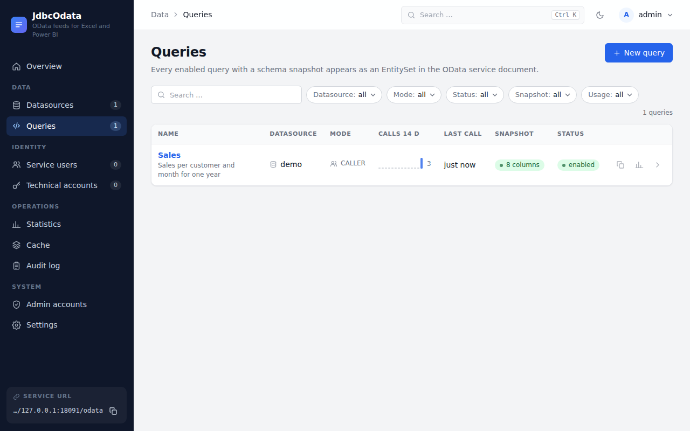
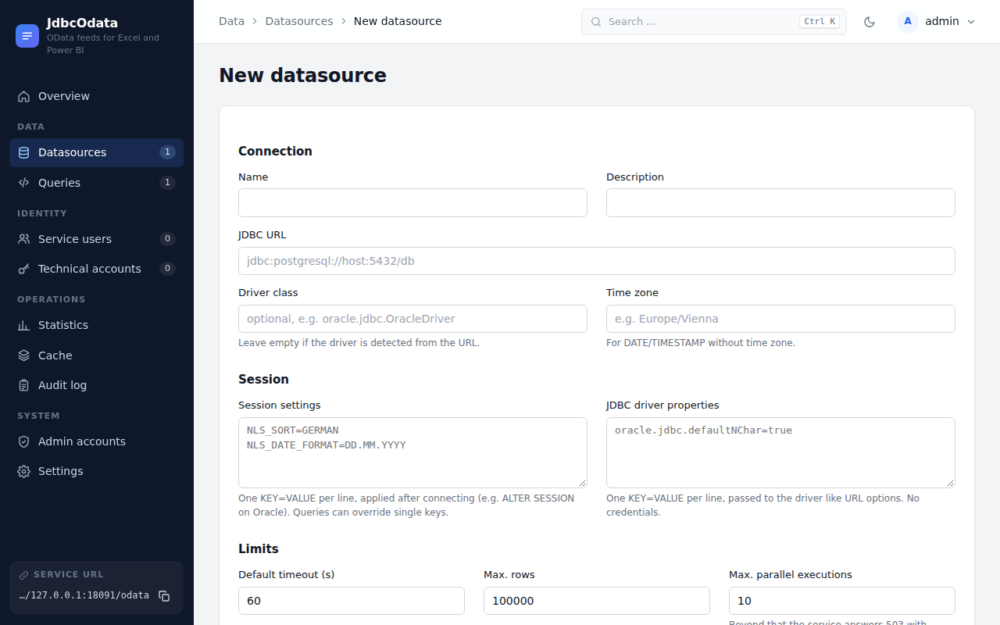
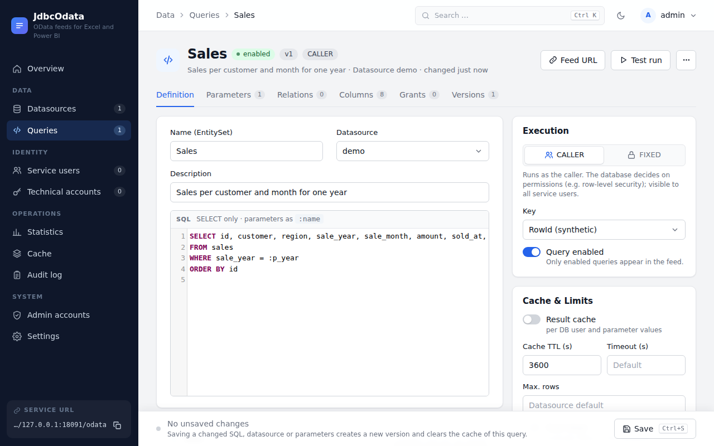
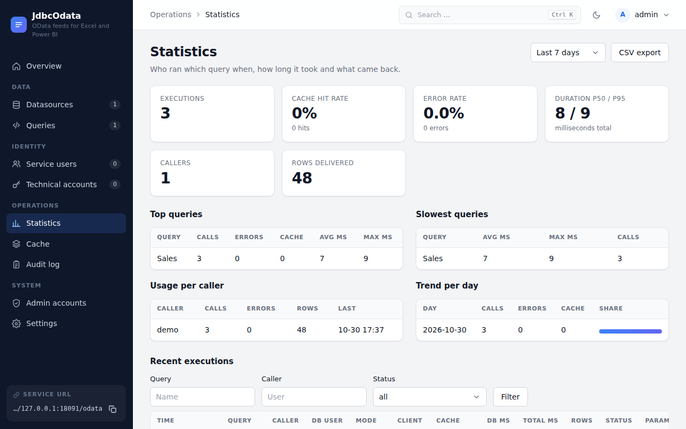

# Admin guide

Everything happens in the admin UI at `/admin`. Most of it is also available through the REST API at `/api/v1`
(HTTP Basic with an admin account). There are two roles: `ADMIN` changes things, `VIEWER` reads.

## Finding your way around

- **Overview** shows the last 24 hours (executions, error rate, cache hit rate, duration), a *Needs attention* list
  (unreachable datasources, queries without a snapshot, recent errors, unused queries), recently changed queries and the
  service URL.
- **Search** with ++ctrl+k++ or ++cmd+k++ finds queries, datasources, service users, accounts and pages.
- **Environment badge:** set `jdbcodata.ui.environment` to `DEV`, `TEST` or `PROD` to label the deployment.
- **Dark mode** follows the system. The moon icon switches it per browser.



## 1. Create a datasource

**Datasources → New datasource**: name, JDBC URL, optional driver class and time zone, and limits (timeout, max. rows,
parallel executions, connections per login). **Test connection** checks it with a database login that is not stored.

```text
jdbc:postgresql://host:5432/db
jdbc:mariadb://host:3306/db
jdbc:oracle:thin:@//host:1521/SERVICE
```

The Oracle driver is not included, and other databases need their driver and an allowed URL prefix. See
[Database drivers](drivers.md).



Passwords do not belong in the URL; such URLs are rejected. So are options that load code, run SQL on connect or switch
off read-only mode.

### Session settings

**Session settings** take one `KEY=VALUE` per line. The service applies them right after connecting. The form lists the
keys allowed for the database in the JDBC URL.

| Database | Statement | Allowed keys |
|---|---|---|
| Oracle | `ALTER SESSION SET …` | `NLS_LANGUAGE`, `NLS_TERRITORY`, `NLS_SORT`, `NLS_DATE_FORMAT`, `NLS_DATE_LANGUAGE`, `NLS_TIMESTAMP_FORMAT`, `NLS_TIMESTAMP_TZ_FORMAT`, `NLS_NUMERIC_CHARACTERS`, `NLS_CURRENCY`, `NLS_ISO_CURRENCY`, `NLS_DUAL_CURRENCY`, `NLS_CALENDAR`, `TIME_ZONE` |
| PostgreSQL | `SELECT set_config(…)` | `DateStyle`, `IntervalStyle`, `TimeZone`, `lc_monetary`, `lc_numeric`, `lc_time`, `search_path`, `extra_float_digits` |
| MySQL, MariaDB | `SET SESSION …` | `time_zone`, `lc_time_names`, `sql_mode`, `collation_connection`, `div_precision_increment` |
| H2 | `SET TIME ZONE …` | `TIME_ZONE` |

```text
NLS_LANGUAGE=GERMAN
NLS_TERRITORY=AUSTRIA
NLS_SORT=GERMAN
NLS_DATE_FORMAT=DD.MM.YYYY
```

- `NLS_LANG` has no effect with the thin driver, because it is an environment variable of the OCI client. Set language,
  territory and formats individually.
- Values may contain letters, digits, spaces and `. , : / + - "`, but no quotes, semicolons or backslashes.
- In PostgreSQL, `DateStyle` must start with `ISO`, for example `ISO, DMY`. Otherwise the JDBC driver drops the connection.
- A query can override single keys under **Session setting overrides** and inherits the rest. It then gets its own
  connections.
- Settings affect the query's SQL, such as `ORDER BY` and `TO_CHAR` without a format mask. OData `$orderby` and `$filter`
  keep comparing binary.

**JDBC driver properties** are passed to the driver like URL options, for example `ApplicationName=jdbcodata`. The same
restrictions apply as for the URL, and credentials are not allowed.

## 2. Create a query

**Queries → New query**. The editor has the tabs **Definition**, **Parameters**, **Relations**, **Columns**, **Grants**
and **Versions**. One bar at the bottom saves everything (++ctrl+s++ or ++cmd+s++).



1. **Name** becomes the entity set: `/odata/<Name>`. Use letters, digits and `_`.
2. **SQL**: `SELECT` only, including `WITH` and `UNION`. Write parameters as `:name` and declare them with type, required
   flag and default. Sensitive parameters are masked in the logs.
3. **Test run** with your own database login shows up to 100 rows, column types and duration.
4. **Save**, then **Take schema snapshot**. The query appears in the feed only after that. Renew the snapshot after every
   SQL change.
5. **Columns**: hide columns or mark key columns (key mode "Columns"). Otherwise the feed uses a synthetic `RowId`.

Every change to SQL, parameters or datasource creates a version that you can restore.

Queries with parameters can also be called as functions: `GetSales(p_year=2024)`.

### Structured columns

SQL arrays (PostgreSQL `text[]`, `int[]`, H2 `ARRAY`) and JSON columns can be published as structured data under
**Publish as**: arrays of values as `Collection(Edm.String)` and similar, arrays of JSON objects as a collection of a
complex type, and single JSON objects as a complex type.

The snapshot derives types and fields from up to 100 sample rows. **Structure** lets you change order, names and types.
Excel shows structured values only as a list or record, so *additionally as text* adds a property `<Column>Text`.

```text
$filter=Tags/any(t:t eq 'New')
$filter=Items/any(p:p/Amount gt 1000)
$select=CustomerData/Country
/odata/Orders(1)/Items/$count
```

### Relations

Link a query to another one, for example `Sales.Customer → Customers` on `CustomerId = CustomerId`. The opposite direction
is entered on the target query with *Many*, and **Partner** connects the two. Relations appear as navigation properties.

```text
/odata/Sales?$expand=Customer
/odata/Customers?$expand=Sales($top=5;$orderby=Amount desc)
/odata/Sales?$filter=Customer/Region eq 'North'
/odata/Customers(1)/Sales?$top=5
```

**Across databases:** the target query may live on another datasource. Each query runs on its own datasource and rows are
matched in the service.

- A pass-through login must be valid on both databases. A service user needs stored credentials for each datasource.
- Numbers compare regardless of type (`1` equals `1.00`), but numbers and text do not (`'0042'` is not `42`). Cast in one of
  the two queries if needed.
- The target query runs in full once per request, with at most 200,000 expanded rows. Keep large master data queries narrow.

## 3. Choose the identity

See the [identity model](identity.md) for service users, technical accounts and grants.

## 4. Push-down

Switch on **Push-down** in the query editor to run `$filter`, `$search`, `$orderby`, `$top`, `$skip`, `$count` and `$apply`
groupings as wrapped SQL in the database, wherever the meaning stays the same. Everything else is still evaluated in memory.
This is useful for large results that clients rarely load in full.

It requires key mode "Columns" with a key column, and PostgreSQL, H2, Oracle, MySQL or MariaDB. Pushed requests bypass the
cache. The response header `X-Push-Down` tells you what ran in the database.

Results match the in-memory evaluation with one known exception: `toupper` uses the database's rules, so `ß` stays `ß` there and becomes `SS` in memory.

## 5. Cache

Enable **Result cache** and set a TTL in the query editor. Entries are kept per database user and parameter values, so nobody
receives a result created for someone else. **Cache** lists entries and invalidates them. Clients can force a refresh with
`?refresh=true`. Changing the SQL invalidates old entries automatically.

## 6. Statistics and audit



**Statistics** shows key figures, top and slowest queries, usage per caller, the trend and raw data with filters and CSV
export. **Audit log** records configuration changes with admin, time and object, admin sign-ins and sign-outs, rejected admin and feed logins with IP address, and test runs with their SQL but without parameter values.

## 7. Admin accounts

**Admin accounts** creates `ADMIN` and `VIEWER` accounts. One active `ADMIN` always remains, and you cannot delete your own
account.

## 8. API keys

**API keys → New key**. A key is meant for machine clients and works either on feeds or on the REST API, never both:

- **Feeds:** The key acts as a service user, with its stored logins and grants. It is not a database login itself, so a
  force-pass-through service user cannot have a key, and there is no fallback to pass-through. Disabling the service
  user also blocks its keys.
- **REST API:** The key acts with the role ADMIN or VIEWER. It cannot create or revoke keys, otherwise a leaked key could
  extend itself.

The key is shown once, and only its hash is stored. It expires after 1 to 3650 days, and *Revoke* takes effect at once.
To rotate, create a second key, switch the client over and revoke the old one. Send it as
`Authorization: Bearer jdo_…`. Clients that only support Basic Auth use the user `apikey` with the key as password.
The execution and audit logs show the caller as `apikey:<name>`.

## 9. Configuration as code

Datasources and queries can be kept in a versioned YAML file. Set `jdbcodata.seed.file` to load it at start; entries are
upserted by name.

```yaml
datasources:
  - name: erp
    jdbcUrl: jdbc:postgresql://erp-db.example.org:5432/erp
    defaultTimeoutSec: 60
    maxConcurrent: 5
    poolSize: 10

queries:
  - name: Sales
    datasource: erp
    sql: |
      SELECT customer, month, amount
      FROM v_sales
      WHERE year = :p_year
    parameters:
      - name: p_year
        type: INT
        required: true
    pushDown: true
```

`contrib/seed-example.yml` in the repository shows more options. Further keys:

| Key | Meaning |
|---|---|
| `snapshotCredentials` | Login used once for the snapshot at start; not stored |
| `keyColumns` | Marks snapshot columns as key |
| `relations` | `name`, `target`, `columns` (own column: target column), `toMany`, `partner` |
| `collectionColumns`, `textCopyColumns` | Publish arrays and JSON as structured data, optionally also as text |
| `sessionSettings`, `driverProperties` | Maps, as in the UI. Query-level `sessionSettings` override the datasource |
