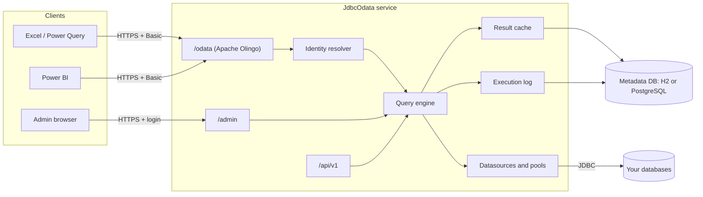
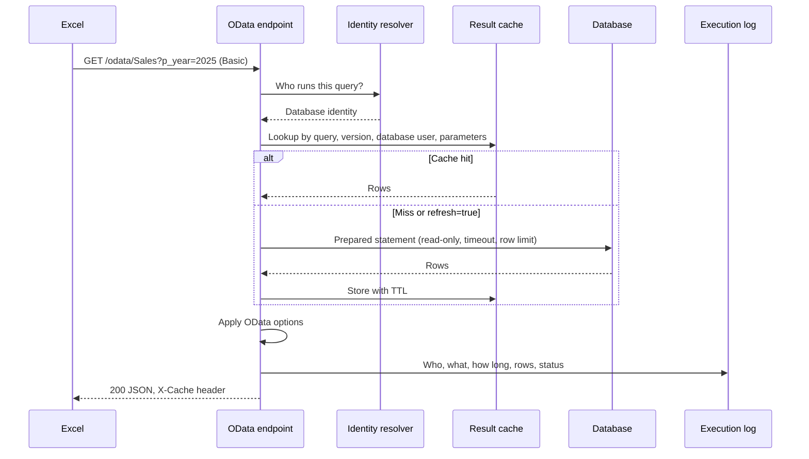

# Architecture

JdbcOdata is a single Spring Boot process. It has no separate query engine or message broker. Its state lives in a metadata database.

## Stack

| Part | Choice |
|---|---|
| Runtime | Java 21 |
| Framework | Spring Boot 4, Spring Security |
| OData | Apache Olingo 5 |
| Database access | JDBC, HikariCP |
| SQL validation | JSqlParser |
| Metadata | H2 file or PostgreSQL, Flyway migrations |
| Admin UI | Thymeleaf, htmx, CodeMirror, no Node build |
| Cache | Caffeine in front of a table in the metadata database |

## A request from Excel

Without push-down, OData options run in memory on the query result. With [push-down](admin-guide.md#4-push-down), they are wrapped around the SQL as far as the meaning stays the same.

The cache key contains the database user, not the password. For a pure pass-through caller, a cache hit therefore still checks the login first, so a wrong password gets 401 rather than cached data.

## Connections

Each identity gets a small HikariCP pool per datasource, identity and session settings, with two connections. Idle pools are closed after a few minutes, so refreshes hit a warm pool, but credentials do not stay open
for long. Every connection is read-only, with auto-commit off and a rollback at the end.

## The OData model

Each enabled query with a schema snapshot becomes an entity set. The snapshot records columns, types and keys, so the model does not depend on a live connection. Relations between queries become navigation properties, and
may span datasources. The feed is built per caller: `$metadata` shows only what this caller may see.

## Data at rest

The metadata database holds datasources, queries and versions, parameters, column snapshots, grants, service users, encrypted credentials, admin accounts, the result cache, the execution log and the audit log. The master key
is never stored there.

## Package layout

| Package | Responsibility |
|---|---|
| `odata` | Olingo servlet, dynamic model, option evaluation |
| `admin` | Admin UI and REST API, accounts, roles |
| `query` | Query definitions, SQL validation, snapshots, execution |
| `identity` | Identity resolution, service users, credentials |
| `datasource` | Datasources, pools, JDBC URL policy, session settings |
| `cache` | Result cache |
| `stats` | Execution log, statistics, retention |
| `security`, `crypto`, `config` | TLS guard, rate limiting, encryption, configuration |
