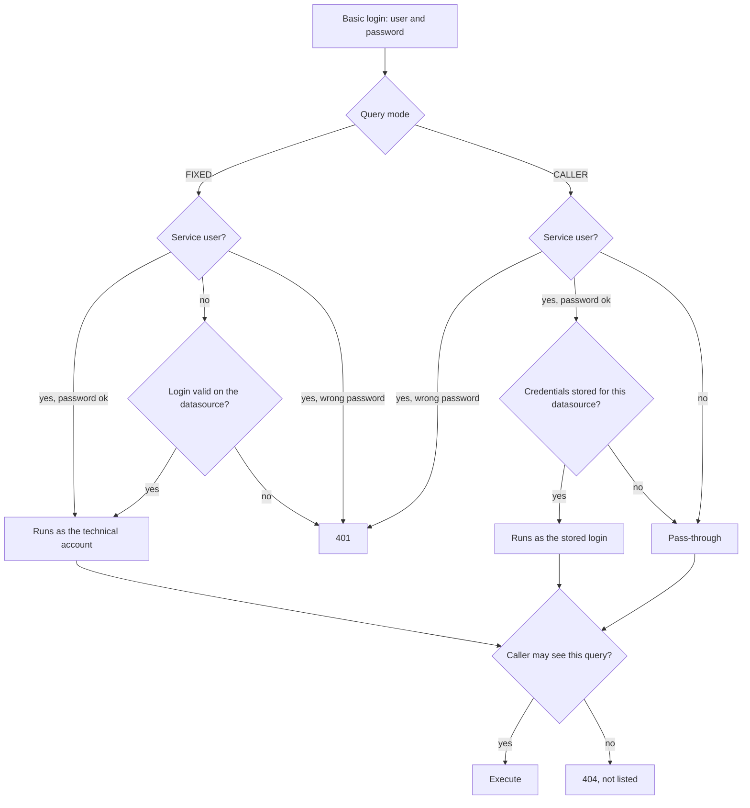

# Identity model

JdbcOdata has no user directory of its own for readers. For each request it works out which **database user** the query runs
as. That decides what the caller sees.

## Three ways to run a query

| Mode | Who signs in | The query runs as | Typical use |
|---|---|---|---|
| CALLER, pass-through | Database user and password | Exactly this login | The database decides on grants, views, row-level security |
| CALLER, service user | Service user and service password | The database login stored for this datasource | One login for several databases, gateways, password rotation without touching Excel |
| FIXED | Any caller with a grant | The technical account of the query | Reports for people without a database account |

CALLER is the default.

## How a request is resolved

## Pass-through

Excel sends database user and password; the service connects with them. The password is not stored or logged, and it is held
in memory only while the connection pool for this login is alive. Idle pools are closed after a few minutes.

The service document and `$metadata` need a valid database login. A caller sees the queries of the datasources that accept the
login. While a database cannot be reached, its queries stay hidden. If no database can be reached, the service answers 503.

A login that a database rejected is not tried again on that database for 5 minutes. So a new account that uses a password the service has just seen rejected can take up to 5 minutes to work. Saving the datasource ends this wait at once, and a different password is always tried.

!!! danger "Every Basic login reaches your database"
    Any login that is not a service user is tried as a database login. Superuser and write accounts must not be able to sign in
    over the network, for example in `pg_hba.conf`: `host all <superuser> all reject`. Accounts with a lockout policy can be
    locked by repeated failed attempts: a user with different passwords on two databases causes one failed login every 5 minutes while working. See [Security](security.md#known-limits).

## Service users

**Service users → New service user**. Use the recommended prefix `svc_` so names do not collide with database users.

- A service user has its own password, stored as a bcrypt hash, and optional groups.
- Store a database login per datasource. These are encrypted with the master key.
- *Force pass-through* ignores stored credentials.
- A service user without stored credentials for a datasource falls back to pass-through.

## Technical accounts and FIXED queries

**Technical accounts → New account** stores a database account per datasource. A FIXED query runs under such an account, whoever
calls it.

Under **Grants** in the query editor you choose who may use a FIXED query: single service users, groups or all authenticated
callers. Others do not see the query and get 404, which does not reveal that it exists.

## Anonymous access

Set `jdbcodata.odata.anonymous-user` to a service user's name, and requests **without** an `Authorization` header run as that user.
This is meant for public demo feeds.

- The user must be enabled, must not force pass-through, and needs stored credentials or FIXED grants.
- A grant for "all authenticated callers" does not include anonymous callers.
- `$metadata` also shows the schema of all CALLER queries, so explorers can see what a login would unlock.
- A request with an `Authorization` header that is not valid HTTP Basic, such as a Bearer token, gets 401 and does not run as this user.
- The execution log records the caller as `anonymous`.
- Anonymous callers do not get database error details, only a reference number.

!!! warning
    Use this for public demo data only. Anyone who can reach the service gets what this user can see.

## Which one should I use?

- People with their own database accounts: **pass-through**.
- Power BI Service through a gateway, scheduled jobs: **service user** with stored credentials.
- A shared report for people without a database account: **FIXED** with grants.
