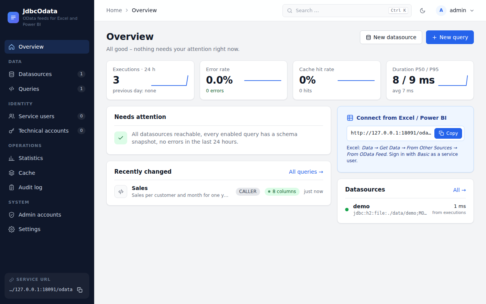

# JdbcOdata

**Publish SQL queries from your databases as OData V4 feeds that Excel and Power BI can open directly.**

An administrator writes a `SELECT` in a web UI. JdbcOdata turns it into an OData feed. People open that feed in Excel
or Power BI with their own database login, and the database decides what they may see. JdbcOdata stays read-only and
adds caching, limits and a complete execution log.

[Get started in 5 minutes](quickstart.md){ .md-button .md-button--primary }
[Try the live demo](https://odata.status20.net/odata/){ .md-button }

## What it does

- **Feeds at runtime.** Create, change and delete queries in the admin UI, by REST API or from a YAML file. No
  deployment, no code.
- **The database stays in charge.** By default every query runs with the caller's own database login, so existing
  grants and row-level security keep working. Passwords are passed through, not stored.
- **Other identities where you need them.** Service users with encrypted stored credentials, and technical accounts
  for reports aimed at people without a database account.
- **Less load on production.** Results can be cached per database user, and filters can optionally be pushed down
  into SQL.
- **A full trail.** Every execution is logged: who, when, which query, duration, rows, cache status, errors. Every
  configuration change lands in an audit log.
- **A broad OData subset.** `$filter`, `$orderby`, `$expand`, `$search`, `$apply`, `$compute`, `$batch`, delta links,
  asynchronous requests and more. See the [feature reference](odata-reference.md).
- **Simple to run.** One Java 21 process on Linux or Windows, or a Docker Compose stack.

## Supported databases

| Database | Driver |
|---|---|
| PostgreSQL | included |
| MySQL, MariaDB | included (MariaDB driver) |
| Oracle | add it yourself, see [Database drivers](drivers.md#oracle) |
| Others, for example SQL Server | add the driver to `lib/` and allow its URL prefix |

## Sister project: OData Online Viewer

The [OData Online Viewer](https://www.odata-viewer.online) shows what an OData service contains: entity sets,
relationships as a diagram, and a live data explorer. It works with any OData service and is a convenient way to
inspect a JdbcOdata feed. The JdbcOdata live demo is one of its featured samples.

## What it is not

JdbcOdata is read-only: no `POST`, `PATCH` or `DELETE` on feeds. There is no SSO, Kerberos or OpenID Connect; clients use
HTTP Basic, so TLS is mandatory for real use. OData V2 and the Atom format are not supported.

## Licence

MIT. The source is on [GitHub](https://github.com/karlkauc/JdbcOdata).
